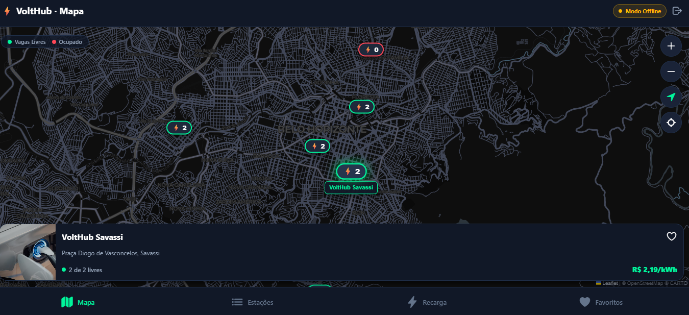
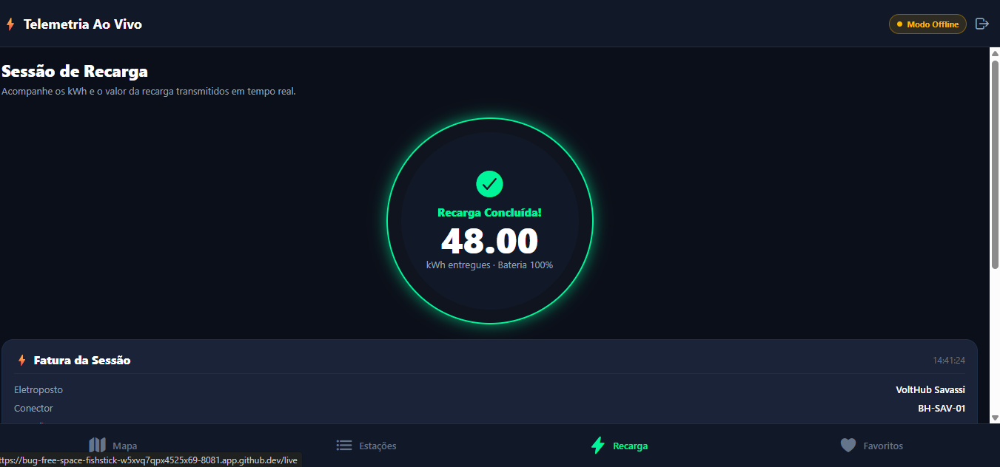
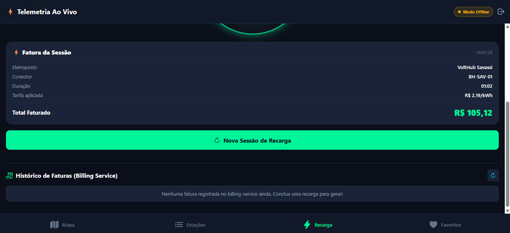

# ⚡ VoltHub Mobile & Web — Multiplatform App

Aplicação multiplataforma (**Android, iOS e Web**) construída com **React Native (Expo SDK 57) + TypeScript** para consumir o ecossistema de recarga de veículos elétricos **VoltHub**, com organização em camadas inspirada em **DDD** e **Clean Architecture**.

As decisões do aplicativo estão registradas em [ADR.md](./ADR.md). A arquitetura dos serviços está em [docs/adr](../../docs/adr/).

---

## 🏗️ Arquitetura (DDD + Clean Architecture)

O código em `src/` é dividido em 4 camadas concêntricas, respeitando a **Regra de Dependência** (camadas internas não conhecem camadas externas nem frameworks de UI):

```text
apps/mobile/src/
├── core/                  # Utilitários transversais (Result<T, E>, AppError, variáveis de ambiente)
├── domain/                # Camada de Domínio Puro (0 dependências de React/Expo)
│   ├── entities/          # Entidades ricas: Station, Charger, User
│   ├── value-objects/     # Objetos de Valor com invariantes: Coordinates (Haversine), Money, ConnectorType, ChargerStatus
│   └── repositories/      # Ports (Contratos/Interfaces): IStationRepository, IFavoritesRepository, IAuthRepository
├── application/           # Casos de Uso (Application Business Rules)
│   └── use-cases/         # GetStationsUseCase, GetStationByIdUseCase, FilterStationsUseCase, ToggleFavoriteStationUseCase, LoginUseCase, OpenChargingSessionUseCase
├── infrastructure/        # Adapters de Saída (Implementações concretas de API HTTP, Mappers, Storage)
│   ├── api/               # apiClient (fetch + timeout), DTOs e FallbackStationsSeed (resiliência offline)
│   ├── mappers/           # StationMapper (DTO <-> Domain Entity)
│   ├── repositories/      # HttpStationRepository, LocalStorageFavoritesRepository, HttpAuthRepository
│   └── storage/           # Persistência universal (@react-native-async-storage/async-storage -> AsyncStorage no Mobile e implementação Web da biblioteca)
├── presentation/          # Camada de Apresentação e UI
│   ├── theme/             # Design System Dark Neon (colors, spacing, radii)
│   ├── state/             # Stores Zustand (useStationsStore, useFavoritesStore, useLiveChargingStore, useAuthStore)
│   └── components/        # Componentes visuais (InteractiveMap, StationCard, ChargerRow, LiveChargingGauge, SearchBar, FilterChips)
└── app/                   # Rotas Expo Router (File-based routing)
    ├── _layout.tsx        # Navegação em Abas (Mapa, Estações, Recarga Ao Vivo, Favoritos)
    ├── login.tsx          # Tela de login (obrigatória; abas protegidas por Tabs.Protected)
    ├── index.tsx          # Mapa Interativo de Belo Horizonte com Bottom Card
    ├── stations/
    │   ├── index.tsx      # Lista de Eletropostos com Busca e Filtros
    │   └── [id].tsx       # Detalhes da Estação, Comodidades e Conectores
    ├── live.tsx           # Telemetria de Recarga em Tempo Real (WebSocket + Medidor Circular)
    └── favorites.tsx      # Eletropostos Favoritos Persistidos Localmente
```

---

## ✅ As 5 Features da Disciplina + Bônus VoltHub

| # | Feature | Implementação no VoltHub Mobile |
|---|---|---|
| **1** | **Lista consumindo API real** | `HttpStationRepository` consome `GET /api/v1/stations` do `bff-web` (com fallback resiliente para as 10 estações de BH caso o Docker esteja desligado) |
| **2** | **Navegação lista → detalhe** | Toque em qualquer `StationCard` ou pin do mapa navega para `/stations/[id]`, exibindo foto, avaliação, horário, comodidades e lista de conectores (`ChargerRow`) |
| **3** | **Busca por texto** | `SearchBar` filtra instantaneamente por nome do posto, endereço/bairro ou comodidade via `Station.matchesSearch()` |
| **4** | **Categoria/filtro estruturado** | `FilterChips` filtra por *Vagas Livres*, *Rápido (>50kW)*, *Plug CCS 2* e *Plug Tipo 2* combinando query params reais na API (`?status=AVAILABLE`, `?fastOnly=true`, `?connector=CCS2`) e `FilterStationsUseCase` |
| **5** | **Favoritos persistidos localmente** | `LocalStorageFavoritesRepository` persiste o `Set` de IDs favoritos via `AsyncStorage` / `localStorage`, sobrevivendo ao fechamento do app |
| **★** | **Login obrigatório** | `login.tsx` autentica no `POST /api/v1/auth/login` do BFF (Keycloak). As abas só existem com sessão; botão **Sair** no header. Falhas sem resposta HTTP permitem uma sessão de demonstração; erros HTTP são mantidos. A rota de login esperada pelo app ainda não existe no BFF desta branch |
| **★** | **Mapa + Telemetria Ao Vivo** | Aba **Mapa** com pins georreferenciados e aba **Recarga** com medidor circular em tempo real (conectado ao `POST /api/v1/reservations` e WebSocket `/ws` do BFF) |

---

## 🚀 Como Executar

### 1. Instalar dependências
```bash
cd apps/mobile
npm ci
```

### 2. Rodar na Web (Navegador)
```bash
npm run web --prefix apps/mobile
```

### 3. Rodar no Android / iOS
```bash
npm run android --prefix apps/mobile
# ou
npm run ios --prefix apps/mobile
```

### 4. Rodar Testes de Domínio e Typecheck
```bash
npm test --prefix apps/mobile
npm run lint --prefix apps/mobile
```

### 5. Testes E2E (Maestro) — Projeto Final

Os 7 flows em [`flows/`](./flows) cobrem as 5 features e usam a convenção de `testID` da disciplina
(`item-list-screen`, `item-card-<id>`, `search-input`, `category-chip-<filtro>`, `detail-screen`,
`detail-title`, `detail-favorite-button`, `detail-back-button`, `tab-favorites`, `favorite-item-<id>`).
Os cenários usam IDs do seed local. O login admite demonstração quando não recebe resposta HTTP, mas um BFF que responde 404 não ativa esse modo. Os flows precisam de dispositivo/emulador, Maestro instalado e dados compatíveis; não foram executados nesta contribuição.

```bash
cd apps/mobile          # a partir da raiz do repositório
npx expo run:android      # com emulador aberto
maestro test flows/       # instalar: https://docs.maestro.dev/getting-started/installing-maestro
```

| Flow | Feature |
|---|---|
| `01-list` | Lista consumindo API (ou seed) |
| `02-detail-navigation` | Lista → detalhe |
| `03-search` | Busca por texto |
| `04-category-filter` | Chip "Vagas Livres" (`?status=AVAILABLE`) |
| `05-favorites` | Favoritar e verificar na aba; reabertura deve ser validada separadamente |
| `06-detail-not-found` | Deep link para estação inexistente mostra estado de erro |
| `07-login-logout` | App abre no login, entrar libera as abas, sair volta ao login |

Todos os flows começam com `clearState` e passam pelo login via `flows/subflows/login.yaml` (credenciais de demonstração pré-preenchidas).


## Ambiente e execução reprodutível

Execute os comandos abaixo a partir da raiz do repositório. Use Node.js compatível com o Expo SDK fixado em `package.json`, npm e as versões do lockfile:

```bash
cd apps/mobile
npm ci
npm test
npm run lint
```

O script `lint` executa a checagem de tipos do TypeScript. Os testes ficam em `test/` e cobrem regras de domínio, filtros, login e sessão de recarga; sua execução não substitui o teste de integração nem o build Android.

### Backend e endereço da API

Para iniciar o ecossistema local, na raiz do repositório:

```bash
docker compose up -d --build
docker compose ps
```

O BFF é exposto na porta 3000 e depende dos demais serviços. Consulte também o [README principal](../../README.md) para o ambiente completo.

Copie `apps/mobile/.env.example` para `apps/mobile/.env.local` e ajuste a URL base, **sem barra final e sem /api/v1**:

```dotenv
EXPO_PUBLIC_API_URL=http://localhost:3000
```

| Ambiente | URL base |
|---|---|
| Navegador na mesma máquina do backend | `http://localhost:3000` |
| Emulador Android com backend no host | `http://10.0.2.2:3000` |
| Celular físico na mesma rede | `http://IP_DA_MAQUINA:3000` |
| Codespaces ou backend remoto | URL HTTPS encaminhada do BFF, acessível pelo dispositivo |

Em celular físico, `localhost` aponta para o próprio telefone e `10.0.2.2` é um endereço específico do emulador. Verifique firewall e acesso ao backend. No Codespaces, a autenticação da porta encaminhada pode impedir chamadas pelo app: confirme o acesso antes de testar e não exponha todo o ambiente indiscriminadamente.

A variável `EXPO_PUBLIC_API_URL` é incorporada ao cliente, portanto não deve conter segredos. Reinicie o Expo após alterá-la e gere outro APK se estiver usando um binário instalado. O endereço WebSocket é derivado da mesma URL, com `ws/wss` e caminho `/ws`.

### Navegador e Codespaces

A partir de `apps/mobile`:

```bash
npm run web -- --host lan --port 8083 --clear
```

Abra a porta indicada no terminal. No Codespaces, use a aba **Portas**. A porta 8081 está reservada ao Keycloak; use 8083 para o Expo. Se estiver ocupada, encerre a instância anterior com Ctrl+C no terminal dela. Configure também a URL do BFF; abrir apenas a interface não valida a integração. Veja as limitações de CORS em [VALIDACAO.md](./docs/VALIDACAO.md).

### Android e geração do APK

Pré-requisitos: JDK compatível com o projeto Android gerado, Android SDK, licenças aceitas e `ANDROID_HOME` configurado. O Android Studio é uma opção para instalar esses componentes; a compilação também pode ser feita por linha de comando no Codespaces.

Em `apps/mobile`, depois de configurar a API:

```bash
npx expo prebuild --platform android
cd android
chmod +x gradlew
./gradlew assembleDebug
```

O build de depuração normalmente depende do Metro para carregar o JavaScript; ele não deve ser tratado como APK autônomo para distribuição. Valide o fluxo no dispositivo com o Metro acessível.

O APK de depuração fica em `apps/mobile/android/app/build/outputs/apk/debug/app-debug.apk`. Baixe e instale no Android. Para executar diretamente em emulador/dispositivo conectado, use `npm run android` na pasta do app. iOS requer macOS e Xcode.

## Roteiro de validação manual

| Cenário | Procedimento | Resultado esperado |
|---|---|---|
| Lista integrada | Entrar com o BFF disponível e abrir Estações | Dados retornados pela API; conferir origem dos dados e requisições |
| Detalhe | Abrir uma estação e voltar | Detalhes correspondentes ao item e navegação funcional |
| Busca | Buscar um nome existente e depois um texto inexistente | Lista filtrada e mensagem de resultado vazio |
| Filtros | Selecionar conector/disponibilidade e combinar com busca | Itens coerentes com ambos os critérios |
| Favoritos | Favoritar, encerrar o app e reabrir sem limpar dados | Favorito permanece; remoção também persiste após reabertura |
| Falha de rede | Interromper acesso ao BFF e repetir operações | Mensagem clara ou indicação de fallback; nunca confundir demonstração com integração |
| Login inválido | Usar credenciais incorretas com BFF disponível | Erro de autenticação, sem liberar acesso às abas |
| Layout | Conferir início/fim da lista e aumentar fonte no Android | Conteúdo legível e sem sobreposição das barras do sistema |

Registre dispositivo, versão do Android, commit, origem dos dados e resultado de cada cenário no PR. Esta tabela é um plano de teste; não afirma que os cenários foram executados.

### Limitações que precisam entrar na demonstração

- O repositório de estações possui um seed fixo de fallback. Ele ajuda a demonstrar a interface quando a chamada falha, mas **não comprova consumo de dados reais**.
- O login real persiste a sessão localmente. Quando não há resposta HTTP, o caso de uso retorna um usuário de demonstração sem token; isso inclui bloqueios de CORS. Portanto, entrar no app não comprova autenticação no Keycloak.
- A telemetria possui cálculo local quando não chegam leituras WebSocket. Movimento no medidor, isoladamente, não comprova integração em tempo real.
- O flow de favoritos verifica a aba, mas não encerra e reabre o aplicativo. Faça a verificação de persistência do roteiro acima.
- O aplicativo está configurado em retrato e tema escuro. Paisagem e alternância de tema não estão declaradas como funcionalidades concluídas.

## Screenshots da entrega

Capturas reais enviadas por Amanda em 02/11/2026, executando a versão Web no Codespaces. **Todas mostram o modo de demonstração offline**; não são evidências de build Android ou de integração HTTP/WebSocket.







Ainda é necessário registrar lista com busca/filtro, detalhe e favoritos após reabertura em dispositivo Android para complementar a demonstração das cinco features.

## Situação da validação

Consulte o [roteiro e as pendências de integração](./docs/VALIDACAO.md). Os resultados de testes automatizados são registrados nesse documento. A integração completa e o build Android continuam pendentes; as capturas acima não os substituem.
